# CS-Hybrid Model — Simulation Flowchart

This document provides mid-level flowcharts of the **CS-Hybrid 1D Coastal Profile Evolution Model** in both Mermaid and PlantUML formats, suitable for use as figures in a scientific paper.

---

## A) Mermaid Diagram

```mermaid
flowchart TD
    %% ── INITIALISATION ─────────────────────────────────────────────────────
    START([Start]) --> A1["<b>load_config()</b> · main.py\nRead YAML: dune/dike geometry,\nconstants, vegetation params"]
    A1 --> A2["<b>Initialize profile</b> · main.py\nBuild dune_x / dune_z dicts\n(10 pivot points)\nBuild substrate_x / substrate_z\n(non-erodible dike/revetment)"]
    A2 --> A3["<b>load_timeseries()</b> · functions.py\nLoad CSV or constant arrays:\nHs, Tp, wave_dir, SWL,\nwind_speed, wind_dir, month"]
    A3 --> A4["<b>Initialize volumes</b> · main.py\nvramp, vbeach, volbar, vdune\nvia partial_volume() / total_volume()"]

    %% ── MAIN TIME LOOP ──────────────────────────────────────────────────────
    A4 --> LOOP_START{{"<b>Time loop</b>\ni = 0 … N−1\n(step dt ≈ 600 s)"}}

    LOOP_START --> B1["Read boundary conditions at step i\nHs, Tp, wave_dir, SWL,\nwind_speed, wind_dir, month"]

    %% ── HYDRODYNAMICS ───────────────────────────────────────────────────────
    B1 --> B2{"Wave direction\nwithin shore-normal\n± 90° (shorn)?"}
    B2 -- "Outside cone\n(offshore)" --> B3["Set h0 = 0\n(no wave forcing this step)"]
    B2 -- "Inside cone\n(onshore)" --> B4["Compute deep-water quantities\nh0 = Hs / √2\nL0 = 1.5613 × (0.95·Tp)²\nForeshore slope β"]

    B3 --> B5["<b>Runup calculation</b> · main.py\nr = (0.158/0.03) × β × √(h0·L0)\nFriction damping via cf\nTWL = r + SWL"]
    B4 --> B5

    B5 --> B6{"TWL > dfoot\n(wave reaches dune toe)?"}
    B6 -- No --> B7["qs = 0,  ql = 0\n(no wave erosion)"]
    B6 -- Yes --> B8["<b>Erosion-flux calc</b> · main.py\nvegred = 1 − min(0.021·Av, 0.28)\nqd = vegred × 4·cimpact × (TWL−dfoot)² / Tp\nPartition: qs (ramp),  ql (overwash)"]

    %% ── AEOLIAN TRANSPORT ───────────────────────────────────────────────────
    B7 --> C1
    B8 --> C1
    C1{"Wind direction\nwithin shore-normal\n± 80°?"}
    C1 -- "Outside cone" --> C2["Set qwnet = 0\n(no aeolian transport)"]
    C1 -- "Inside cone" --> C3["<b>Aeolian flux calc</b> · main.py\nwshear = wspeed·κ / ln(z/z0)\nwcrit = awind · √((ρs−ρa)/ρa · g · d50)\nqwnet > 0 if wshear > wcrit"]

    C2 --> C4
    C3 --> C4
    C4["<b>deposition_dune()</b> · functions.py\nwind_veg_reduction() per compartment\ncu = 1.5×10⁻⁴ · (|u|−tu10)³ / |u|\nFstar (deposition probability) per zone\n→ qs_ramp, qs_crest, qs_lee  [m³/m/step]"]

    %% ── SUBTIDAL BAR ────────────────────────────────────────────────────────
    C4 --> D1["<b>subaq()</b> · functions.py\nDEAN = H0 / (wfall · T)\nVOLBAREQ = CB · DEAN^1.33 · STP · L0²\nΛ = DCOEFF · DEAN^−0.5\nDVOL = (VOLBAREQ − VOLBAR) · (1 − e^(−Λ·dt))\n→ qbar, dvol  [m³/m/step]"]

    %% ── MORPHODYNAMIC UPDATE ────────────────────────────────────────────────
    D1 --> E1["<b>morpho_update()</b> · functions.py\nCompute net erosion:\nerod = (qs + ql) · dt"]

    E1 --> E2{"erod > 0?\n(Erosion)"}

    E2 -- "Yes — Erosion" --> E3{"Dike exposed?\n(r + SWL ≤ s_hs + dfoot)"}
    E3 -- "Yes\n(dike exposed)" --> E4["Cap erosion at dike face\nFind runup_reach_dike_x\nbrentq → new ramp/crest position\ndeltavramp_ero, erod_ramp updated"]
    E3 -- "No\n(dike submerged)" --> E5["Full overwash dynamics\nbrentq → lower crest position\nql·dt volume deposited on lee\nerod_overwash accumulated"]

    E2 -- "No — Accretion" --> E6["<b>Ramp deposition</b>\nbrentq → new sramp height or ys_toe\nHandle dike-face filling if ramp\nreaches substrate_x[3..4]"]
    E6 --> E7["<b>Crest deposition</b>\ndetach_tag = 0/1/2 (profile state)\nbrentq → expand crest trapezoid\nor overflow into ramp/lee"]
    E7 --> E8["<b>Lee deposition</b>\nbrentq → build lee slope\nor fill behind-dike cavity\n(Shapely geometry for intersections)"]

    E4 --> E9["Updated dune_x / dune_z\ndeltavramp, erod_overwash"]
    E5 --> E9
    E8 --> E9

    %% ── VEGETATION ──────────────────────────────────────────────────────────
    E9 --> F1{"cumdt ≥ vegdt\n(30-day interval)?"}
    F1 -- "No" --> F3["Skip vegetation update"]
    F1 -- "Yes" --> F2["<b>vegNield_seasonal()</b> · functions.py\nSedimentation rate per zone (dh_df/dt/db)\nPiecewise-linear growth response\n(−0.6 … +2.2 m/yr → 0 … 0.2 m³/m)\nseasonal_factor() → winter decay\n2-species balance: ρ1 + ρ2 ≤ 1\nUpdate rhov_df, rhov_dt, rhov_db,\nrhov_df2, rhov_dt2, rhov_db2"]

    %% ── VOLUME & BEACH UPDATE ───────────────────────────────────────────────
    F2 --> G1
    F3 --> G1
    G1["<b>Volume update</b> · main.py\nvramp = ramp_volume()\nvdune = total_volume()\nvbeach += (−qwnet − qslr + qnour − qbar)·dt\n           + vnourb + deltavramp_ero\nShoreline = f(vbeach, ramp_toe, dclos)"]

    %% ── MASS CONSERVATION (OPTIONAL) ────────────────────────────────────────
    G1 --> H1{"check_mass_\nconservation?"}
    H1 -- "Yes" --> H2["<b>mass_conservation.py</b>\ncalculate_compartment_volumes()\nCompute dune/beach/bar errors\nStore in results['conservation']"]
    H1 -- "No" --> H3
    H2 --> H3

    %% ── STORE OUTPUTS ───────────────────────────────────────────────────────
    H3["<b>Store results</b> · main.py\nresults: dune_x/z, vramp, vbeach,\nvdune, volbar, wave_height, runup,\nTWL, dune_height, shoreline,\nrhov_df/dt/db, rhov_df2/dt2/db2,\nqs_ramp/crest/lee, qbar  (20+ series)"]

    %% ── LOOP BACK OR FINISH ─────────────────────────────────────────────────
    H3 --> I1{"i < N−1?"}
    I1 -- "Yes → next step" --> LOOP_START
    I1 -- "No → done" --> J1["<b>Write output pickle</b> · main.py\nsave results dict to .pkl file"]

    J1 --> J2{"save_evolution_\nmovie?"}
    J2 -- "Yes" --> J3["Assemble profile snapshots\ninto animated GIF"]
    J2 -- "No" --> STOP
    J3 --> STOP([End])

    %% ── STYLING ─────────────────────────────────────────────────────────────
    classDef init    fill:#d4ecd4,stroke:#2e7d32,color:#000
    classDef loop    fill:#fff9c4,stroke:#f9a825,color:#000
    classDef hydro   fill:#b3e0f7,stroke:#0277bd,color:#000
    classDef aeolian fill:#ffe0b2,stroke:#e65100,color:#000
    classDef bar     fill:#e8d5f5,stroke:#6a1b9a,color:#000
    classDef morpho  fill:#fce4ec,stroke:#880e4f,color:#000
    classDef veg     fill:#c8e6c9,stroke:#1b5e20,color:#000
    classDef vol     fill:#e0f2f1,stroke:#004d40,color:#000
    classDef out     fill:#f5f5f5,stroke:#424242,color:#000

    class START,A1,A2,A3,A4 init
    class LOOP_START,B1 loop
    class B2,B3,B4,B5,B6,B7,B8 hydro
    class C1,C2,C3,C4 aeolian
    class D1 bar
    class E1,E2,E3,E4,E5,E6,E7,E8,E9 morpho
    class F1,F2,F3 veg
    class G1 vol
    class H1,H2,H3 out
    class I1,J1,J2,J3,STOP out
```

---

## B) PlantUML Diagram

```plantuml
@startuml CS-Hybrid Simulation Flowchart

skinparam backgroundColor #FFFFFF
skinparam activity {
  BackgroundColor #F5F5F5
  BorderColor     #424242
  FontSize        12
}
skinparam decision {
  BackgroundColor #FFF9C4
  BorderColor     #F9A825
}
skinparam ArrowColor #37474F
skinparam roundCorner 8

title CS-Hybrid 1D Coastal Profile Evolution Model\nMid-Level Simulation Flowchart

start

' ── INITIALISATION ──────────────────────────────────────────────────────────
#d4ecd4:load_config()  [main.py]\nRead YAML → dune/dike geometry, constants, vegetation params;
#d4ecd4:Initialize profile  [main.py]\nBuild dune_x / dune_z (10 pivot points)\nBuild substrate_x / substrate_z (non-erodible);
#d4ecd4:load_timeseries()  [functions.py]\nLoad CSV or constant arrays:\nHs, Tp, wave_dir, SWL, wind_speed, wind_dir, month;
#d4ecd4:Initialize volumes  [main.py]\nvramp, vbeach, volbar, vdune\n← partial_volume() / total_volume();

' ── MAIN TIME LOOP ──────────────────────────────────────────────────────────
while (Time loop  i = 0 … N−1  [step dt ≈ 600 s]) is (next step)

  #fff9c4:Read boundary conditions at step i\nHs, Tp, wave_dir, SWL, wind_speed, wind_dir, month;

  ' -- HYDRODYNAMICS ----------------------------------------------------------
  if (wave_dir within shore-normal ± 90°?) then (Yes — onshore)
    #b3e0f7:Compute h0 = Hs / √2,  L0 = 1.5613 × (0.95·Tp)²\nForeshore slope β;
  else (No — offshore)
    #b3e0f7:Set h0 = 0  (no wave forcing);
  endif

  #b3e0f7:Runup calculation  [main.py]\nr = (0.158/0.03) × β × √(h0·L0)\nFriction damping via cf\nTWL = r + SWL;

  if (TWL > dfoot?) then (Yes)
    #b3e0f7:Erosion-flux calculation  [main.py]\nvegred = 1 − min(0.021·Av, 0.28)\nqd = vegred × 4·cimpact × (TWL−dfoot)² / Tp\nPartition → qs (ramp),  ql (overwash);
  else (No)
    #b3e0f7:qs = 0,  ql = 0;
  endif

  ' -- AEOLIAN TRANSPORT -------------------------------------------------------
  if (wind_dir within shore-normal ± 80°?) then (Yes — onshore)
    #ffe0b2:Aeolian flux calculation  [main.py]\nwshear = wspeed·κ / ln(z / z0)\nwcrit = awind · √((ρs−ρa)/ρa · g · d50)\nqwnet > 0 if wshear > wcrit;
  else (No — offshore)
    #ffe0b2:Set qwnet = 0;
  endif

  #ffe0b2:deposition_dune()  [functions.py]\nwind_veg_reduction() per compartment\ncu = 1.5×10⁻⁴ · (|u|−tu10)³ / |u|\nFstar (deposition probability) per zone\n→ qs_ramp,  qs_crest,  qs_lee  [m³/m/step];

  ' -- SUBTIDAL BAR ------------------------------------------------------------
  #e8d5f5:subaq()  [functions.py]\nDEAN = H0 / (wfall·T)\nVOLBAREQ = CB · DEAN^1.33 · STP · L0²\nΛ = DCOEFF · DEAN^−0.5\nDVOL = (VOLBAREQ − VOLBAR) · (1 − e^(−Λ·dt))\n→ qbar,  dvol  [m³/m/step];

  ' -- MORPHODYNAMIC UPDATE ----------------------------------------------------
  #fce4ec:morpho_update()  [functions.py]\nNet erosion:  erod = (qs + ql) · dt;

  if (erod > 0?  (Erosion)) then (Yes)
    if (Dike exposed?  r + SWL ≤ s_hs + dfoot) then (Yes)
      #fce4ec:Cap erosion at dike face\nbrentq → new ramp/crest position\ndeltavramp_ero, erod_ramp updated;
    else (No — dike submerged)
      #fce4ec:Full overwash dynamics\nbrentq → lower crest position\nql·dt deposited on lee slope\nerod_overwash accumulated;
    endif
  else (No — Accretion)
    #fce4ec:Ramp deposition\nbrentq → new sramp height or ys_toe\nHandle dike-face filling if needed;
    #fce4ec:Crest deposition\ndetach_tag = 0/1/2 (profile state)\nbrentq → expand crest trapezoid\nor overflow into ramp/lee;
    #fce4ec:Lee deposition\nbrentq → build lee slope landward\nor fill behind-dike cavity\n(Shapely geometry for intersections);
  endif

  note right
    Updated dune_x / dune_z
    deltavramp, erod_overwash
  end note

  ' -- VEGETATION UPDATE -------------------------------------------------------
  if (cumdt ≥ vegdt  (30-day interval)?) then (Yes)
    #c8e6c9:vegNield_seasonal()  [functions.py]\nSedimentation rate per zone\n(dh_df, dh_dt, dh_db)\nPiecewise-linear growth response\n(−0.6 to +2.2 m/yr → growth 0…0.2 m³/m)\nseasonal_factor() → winter decay\n2-species balance: ρ₁ + ρ₂ ≤ 1\nUpdate rhov_df, rhov_dt, rhov_db,\nrhov_df2, rhov_dt2, rhov_db2;
  endif

  ' -- VOLUME AND BEACH UPDATE -------------------------------------------------
  #e0f2f1:Volume update  [main.py]\nvramp ← ramp_volume()\nvdune ← total_volume()\nvbeach += (−qwnet − qslr + qnour − qbar)·dt\n              + vnourb + deltavramp_ero\nShoreline position ← f(vbeach, ramp_toe, dclos);

  ' -- MASS CONSERVATION (OPTIONAL) -------------------------------------------
  if (check_mass_conservation?) then (Yes)
    #f5f5f5:mass_conservation.py\ncalculate_compartment_volumes()\nCompute dune/beach/bar errors\nStore in results['conservation'];
  endif

  ' -- STORE OUTPUTS -----------------------------------------------------------
  #f5f5f5:Store results  [main.py]\ndune_x/z, vramp, vbeach, vdune, volbar\nwave_height, runup, TWL, dune_height\nshoreline, rhov_df/dt/db, rhov_df2/dt2/db2\nqs_ramp/crest/lee, qbar  (20+ time series);

endwhile (All steps complete)

' ── OUTPUT / POST-PROCESSING ────────────────────────────────────────────────
#d4ecd4:Write output pickle  [main.py]\nSave full results dict to .pkl file;

if (save_evolution_movie?) then (Yes)
  #d4ecd4:Assemble profile snapshots\ninto animated GIF;
endif

stop

@enduml
```

---

## Legend

### Module Colour Key (Mermaid)

| Colour | Module / Stage | Description |
|--------|---------------|-------------|
| 🟢 Green | **Initialisation** | `load_config()`, profile setup, time-series loading |
| 🟡 Yellow | **Time loop** | Main integration loop header and BC reading |
| 🔵 Blue | **Hydrodynamics** | Wave direction filter, runup, erosion-potential calculation |
| 🟠 Orange | **Aeolian transport** | Wind direction filter, shear-velocity check, `deposition_dune()` |
| 🟣 Purple | **Subtidal bar** | `subaq()` — Dean parameter, bar equilibrium, volume change |
| 🔴 Red | **Morphodynamics** | `morpho_update()` — erosion/accretion branching, dike interaction |
| 🌿 Dark green | **Vegetation** | `vegNield_seasonal()` — 2-species seasonal growth |
| 🩵 Teal | **Volume & beach** | Volume recalculation, shoreline update |
| ⬜ Grey | **Output** | Mass conservation, result storage, file writing |

---

### Abbreviations

| Abbreviation | Meaning |
|--------------|---------|
| **Hs** | Significant wave height [m] |
| **Tp** | Peak wave period [s] |
| **h0** | RMS wave height = Hs / √2 [m] |
| **L0** | Deep-water wavelength = 1.5613 × (0.95·Tp)² [m] |
| **SWL** | Still water level (tide + surge) [m above MSL] |
| **TWL** | Total water level = runup r + SWL [m] |
| **r** | Wave runup height [m] |
| **dfoot** | Dune toe elevation above MSL [m] |
| **β (beta)** | Foreshore slope [-] |
| **cf** | Friction coefficient [-] |
| **qs** | Seaward erosion sediment flux [m³/m/s] |
| **ql** | Overwash sediment flux (lee) [m³/m/s] |
| **qd** | Total wave-driven erosion flux [m³/m/s] |
| **qwnet** | Net aeolian (wind) sediment flux from beach [m³/m/s] |
| **qbar** | Subtidal bar sediment flux [m³/m/s] |
| **wshear** | Wind shear velocity [m/s] |
| **wcrit** | Critical shear velocity for sediment motion [m/s] |
| **cu** | Aeolian sediment concentration [-] |
| **Fstar** | Combined deposition probability (vegetation + velocity gradient) [-] |
| **qs_ramp/crest/lee** | Aeolian sediment distributed to each dune zone [m³/m/step] |
| **DEAN** | Dean parameter = H0 / (wfall · T) [-] |
| **VOLBAREQ** | Equilibrium bar volume [m³/m] |
| **Λ (LAMBDA)** | Bar response coefficient [1/s] |
| **erod** | Net erosion volume per time step [m³/m] |
| **vramp** | Volume of seaward dune ramp [m³/m] |
| **vbeach** | Beach volume [m³/m] |
| **vdune** | Total dune volume [m³/m] |
| **volbar** | Subtidal bar volume [m³/m] |
| **betas / betal** | Seaward / leeward dune slope angles [-] |
| **betas_hs / betal_hs** | Seaward / leeward hard-structure slope angles [-] |
| **s_hs** | Dike crest height above substrate [m] |
| **vegred** | Vegetation-induced erosion reduction factor [0–1] |
| **Av** | Vegetation frontal area density [m²/m²] |
| **rhov_df/dt/db** | Vegetation density (species 1): dune-foot / dune-top / dune-back [-] |
| **rhov_df2/dt2/db2** | Vegetation density (species 2): dune-foot / dune-top / dune-back [-] |
| **vegdt** | Vegetation update interval [s] (default: 30 days = 2.592 × 10⁶ s) |
| **cumdt** | Accumulated time since last vegetation update [s] |
| **shorn** | Shore-normal orientation [degrees from North] |
| **d50** | Median grain diameter [m] |
| **ρs / ρa** | Sediment / air density [kg/m³] |
| **κ (kappa)** | von Kármán constant (≈ 0.41) [-] |
| **z** | Anemometer height [m] |
| **z0** | Aerodynamic roughness length = d50 / 30 [m] |
| **dclos** | Closure depth (depth of no motion) [m] |
| **SLR** | Sea-level rise rate [m/s] |
| **brentq** | Brent's method root-finder from `scipy.optimize` |
| **dt** | Simulation time step [s] (default: 600 s) |
| **N** | Total number of time steps |
| **MSL** | Mean Sea Level |

---

### Main Components

| Component | File | Role |
|-----------|------|------|
| `run_model()` | `main.py` | Top-level driver: orchestrates all phases per time step |
| `load_config()` | `main.py` | Parses YAML configuration into `SimpleNamespace` objects |
| `load_timeseries()` | `functions.py` | Reads CSV boundary-condition time series |
| `deposition_dune()` | `functions.py` | Distributes aeolian flux to ramp / crest / lee zones |
| `wind_veg_reduction()` | `functions.py` | Attenuates wind speed through vegetation canopy |
| `subaq()` | `functions.py` | Subtidal bar equilibrium and volume-change model |
| `morpho_update()` | `functions.py` | Master morphodynamic updater (~1 700 lines); handles all erosion/accretion cases and dike interactions using `brentq` root-finding |
| `vegNield_seasonal()` | `functions.py` | Two-species seasonal vegetation growth/decay model |
| `seasonal_factor()` | `functions.py` | Monthly growth multiplier (summer peak, winter minimum) |
| `ramp_volume()` | `functions.py` | Trapezoidal integration of seaward ramp volume |
| `lee_volume()` | `functions.py` | Trapezoidal integration of leeward slope volume |
| `total_volume()` | `functions.py` | Full dune volume above non-erodible substrate |
| `partial_volume()` | `functions.py` | Dune volume between two cross-shore positions |
| `FALVEL()` | `functions.py` | Sediment fall velocity (Stokes / Oseen formulation) |
| `calculate_compartment_volumes()` | `mass_conservation.py` | Dune + beach + bar volumes for mass-balance audit |
