# CS-Hybrid Model — Simulation Flowchart

This document provides a scientific overview flowchart of the **CS-Hybrid 1D Coastal Profile Evolution Model** in both Mermaid and PlantUML formats, suitable for use as figures in a scientific paper.

---

## A) Mermaid Diagram

```mermaid
flowchart TD
    %% ── INITIALISATION ─────────────────────────────────────────────────────
    START([Start]) --> A1["Read model configuration\nCoastal geometry, physical constants,\nvegetation & structure parameters"]
    A1 --> A2["Initialise coastal profile\nDune–dike cross-shore geometry\nNon-erodible substrate definition"]
    A2 --> A3["Load forcing time series\nWave conditions, water levels, wind"]
    A3 --> A4["Initialise sediment volumes\nBeach, dune, subtidal bar compartments"]

    %% ── MAIN TIME LOOP ──────────────────────────────────────────────────────
    A4 --> LOOP_START{{"Time loop\n(10-min time steps)"}}

    LOOP_START --> B1["Read boundary conditions\nHs, Tp, wave direction, SWL\nWind speed & direction"]

    %% ── HYDRODYNAMICS ───────────────────────────────────────────────────────
    B1 --> B2{"Onshore wave\ndirection?"}
    B2 -- "No\n(offshore)" --> B3["No wave forcing"]
    B2 -- "Yes\n(onshore)" --> B4["Compute wave parameters\nRMS wave height, deep-water wavelength\nForeshore slope"]

    B3 --> B5["Compute wave runup\nEmpirical runup formula\nFriction damping\nTotal Water Level = runup + SWL"]
    B4 --> B5

    B5 --> B6{"TWL exceeds\ndune toe?"}
    B6 -- No --> B7["No wave erosion\nthis time step"]
    B6 -- Yes --> B8["Compute wave-driven erosion flux\nVegetation attenuation factor\nPartition: ramp erosion + overwash flux"]

    %% ── AEOLIAN TRANSPORT ───────────────────────────────────────────────────
    B7 --> C1
    B8 --> C1
    C1{"Onshore wind\ndirection?"}
    C1 -- "No\n(offshore)" --> C2["No aeolian transport"]
    C1 -- "Yes\n(onshore)" --> C3["Compute aeolian transport flux\nWind shear velocity vs.\ncritical threshold for sediment motion"]

    C2 --> C4
    C3 --> C4
    C4["Distribute aeolian deposition across dune\nVegetation trapping efficiency per zone\nSediment flux to: ramp, crest, lee"]

    %% ── SUBTIDAL BAR ────────────────────────────────────────────────────────
    C4 --> D1["Update subtidal bar\nDean parameter → equilibrium bar volume\nExponential relaxation toward equilibrium"]

    %% ── MORPHODYNAMIC UPDATE ────────────────────────────────────────────────
    D1 --> E1["Compute net wave-driven\nsediment flux"]

    E1 --> E2{"Net erosion\nor accretion?"}

    E2 -- "Erosion" --> E3{"Hard structure\nexposed by waves?"}
    E3 -- "Yes" --> E4["Structure-limited erosion\nCap dune retreat at structure face"]
    E3 -- "No" --> E5["Overwash dynamics\nSediment transported to lee slope"]

    E2 -- "Accretion" --> E6["Seaward ramp deposition\nGeometric profile update"]
    E6 --> E7["Crest deposition\nExpand or raise dune crest"]
    E7 --> E8["Lee-slope deposition\nBuild landward slope\nStructure interaction if applicable"]

    E4 --> F1
    E5 --> F1
    E8 --> F1

    %% ── VEGETATION ──────────────────────────────────────────────────────────
    F1{"Vegetation update\ninterval reached?\n(monthly)"}
    F1 -- "No" --> G1
    F1 -- "Yes" --> F2["Update vegetation density\nTwo-species competition model\nSedimentation-rate growth response\nSeasonal growth/decay cycle\nDune foot, crest & lee zones"]

    %% ── VOLUME & BEACH UPDATE ───────────────────────────────────────────────
    F2 --> G1
    G1["Update sediment volumes\nBeach: aeolian export + bar exchange + SLR\nDune: ramp, crest, lee contributions\nNew shoreline position"]

    %% ── STORE OUTPUTS ───────────────────────────────────────────────────────
    G1 --> H1["Store time-step outputs\nMorphology, volumes, wave conditions\nVegetation state, sediment fluxes"]

    %% ── LOOP BACK OR FINISH ─────────────────────────────────────────────────
    H1 --> I1{"Simulation\ncomplete?"}
    I1 -- "No → next step" --> LOOP_START
    I1 -- "Yes" --> J1["Write output\nTime series of all model variables"]

    J1 --> STOP([End])

    %% ── STYLING ─────────────────────────────────────────────────────────────
    classDef init    fill:#d4ecd4,stroke:#2e7d32,color:#000
    classDef loop    fill:#fff9c4,stroke:#f9a825,color:#000
    classDef hydro   fill:#b3e0f7,stroke:#0277bd,color:#000
    classDef aeolian fill:#ffe0b2,stroke:#e65100,color:#000
    classDef bar     fill:#e8d5f5,stroke:#6a1b9a,color:#000
    classDef morpho  fill:#fce4ec,stroke:#880e4f,color:#000
    classDef veg     fill:#c8e6c9,stroke:#1b5e20,color:#000
    classDef vol     fill:#e0f2f1,stroke:#004d40,color:#000
    classDef out     fill:#f5f5f5,stroke:#424242,color:#000

    class START,A1,A2,A3,A4 init
    class LOOP_START,B1 loop
    class B2,B3,B4,B5,B6,B7,B8 hydro
    class C1,C2,C3,C4 aeolian
    class D1 bar
    class E1,E2,E3,E4,E5,E6,E7,E8 morpho
    class F1,F2 veg
    class G1 vol
    class H1,I1,J1,STOP out
```

---

## B) PlantUML Diagram

```plantuml
@startuml CS-Hybrid Simulation Flowchart

skinparam backgroundColor #FFFFFF
skinparam activity {
  BackgroundColor #F5F5F5
  BorderColor     #424242
  FontSize        12
}
skinparam decision {
  BackgroundColor #FFF9C4
  BorderColor     #F9A825
}
skinparam ArrowColor #37474F
skinparam roundCorner 8

title CS-Hybrid 1D Coastal Profile Evolution Model\nScientific Overview Flowchart

start

' ── INITIALISATION ──────────────────────────────────────────────────────────
#d4ecd4:Read model configuration\nCoastal geometry, physical constants,\nvegetation & structure parameters;
#d4ecd4:Initialise coastal profile\nDune–dike cross-shore geometry\nNon-erodible substrate definition;
#d4ecd4:Load forcing time series\nWave conditions, water levels, wind;
#d4ecd4:Initialise sediment volumes\nBeach, dune, subtidal bar compartments;

' ── MAIN TIME LOOP ──────────────────────────────────────────────────────────
while (Time loop — 10-min time steps) is (next step)

  #fff9c4:Read boundary conditions\nHs, Tp, wave direction, SWL\nWind speed & direction;

  ' -- HYDRODYNAMICS ----------------------------------------------------------
  if (Onshore wave direction?) then (Yes)
    #b3e0f7:Compute wave parameters\nRMS wave height, deep-water wavelength\nForeshore slope;
  else (No — offshore)
    #b3e0f7:No wave forcing this time step;
  endif

  #b3e0f7:Compute wave runup\nEmpirical runup formula · friction damping\nTotal Water Level = runup + SWL;

  if (TWL exceeds dune toe?) then (Yes)
    #b3e0f7:Compute wave-driven erosion flux\nVegetation attenuation factor\nPartition: ramp erosion + overwash flux;
  else (No)
    #b3e0f7:No wave erosion this time step;
  endif

  ' -- AEOLIAN TRANSPORT -------------------------------------------------------
  if (Onshore wind direction?) then (Yes)
    #ffe0b2:Compute aeolian transport flux\nWind shear velocity vs.\ncritical threshold for sediment motion;
  else (No — offshore)
    #ffe0b2:No aeolian transport;
  endif

  #ffe0b2:Distribute aeolian deposition across dune\nVegetation trapping efficiency per zone\nSediment flux to: ramp, crest, lee;

  ' -- SUBTIDAL BAR ------------------------------------------------------------
  #e8d5f5:Update subtidal bar\nDean parameter → equilibrium bar volume\nExponential relaxation toward equilibrium;

  ' -- MORPHODYNAMIC UPDATE ----------------------------------------------------
  #fce4ec:Compute net wave-driven sediment flux;

  if (Net erosion or accretion?) then (Erosion)
    if (Hard structure exposed by waves?) then (Yes)
      #fce4ec:Structure-limited erosion\nCap dune retreat at structure face;
    else (No)
      #fce4ec:Overwash dynamics\nSediment transported to lee slope;
    endif
  else (Accretion)
    #fce4ec:Seaward ramp deposition\nGeometric profile update;
    #fce4ec:Crest deposition\nExpand or raise dune crest;
    #fce4ec:Lee-slope deposition\nBuild landward slope\nStructure interaction if applicable;
  endif

  ' -- VEGETATION UPDATE -------------------------------------------------------
  if (Vegetation update interval reached? (monthly)) then (Yes)
    #c8e6c9:Update vegetation density\nTwo-species competition model\nSedimentation-rate growth response\nSeasonal growth/decay cycle\nDune foot, crest & lee zones;
  endif

  ' -- VOLUME AND BEACH UPDATE -------------------------------------------------
  #e0f2f1:Update sediment volumes\nBeach: aeolian export + bar exchange + SLR\nDune: ramp, crest, lee contributions\nNew shoreline position;

  ' -- STORE OUTPUTS -----------------------------------------------------------
  #f5f5f5:Store time-step outputs\nMorphology, volumes, wave conditions\nVegetation state, sediment fluxes;

endwhile (Simulation complete)

' ── OUTPUT / POST-PROCESSING ────────────────────────────────────────────────
#d4ecd4:Write output\nTime series of all model variables;

stop

@enduml
```

---

## Legend

### Module Colour Key

| Colour | Stage | Description |
|--------|-------|-------------|
| 🟢 Green | **Initialisation** | Configuration, profile setup, time-series loading |
| 🟡 Yellow | **Time loop** | Main integration loop and boundary condition reading |
| 🔵 Blue | **Hydrodynamics** | Wave direction filter, runup, erosion-potential calculation |
| 🟠 Orange | **Aeolian transport** | Wind direction filter, shear-velocity threshold, dune deposition |
| 🟣 Purple | **Subtidal bar** | Dean parameter, bar equilibrium volume, relaxation |
| 🔴 Red | **Morphodynamics** | Erosion/accretion geometry update, hard-structure interaction |
| 🌿 Dark green | **Vegetation** | Two-species seasonal growth and decay model |
| 🩵 Teal | **Volume & beach** | Sediment volume bookkeeping and shoreline update |
| ⬜ Grey | **Output** | Result storage and file writing |

---

### Key Variables

| Symbol | Meaning |
|--------|---------|
| **Hs** | Significant wave height [m] |
| **Tp** | Peak wave period [s] |
| **SWL** | Still water level (tide + surge) [m NAP] |
| **TWL** | Total water level = wave runup + SWL [m NAP] |
| **β** | Foreshore slope [-] |
| **qs** | Wave-driven erosion flux (ramp) [m³/m/s] |
| **ql** | Overwash flux (lee slope) [m³/m/s] |
| **qw** | Net aeolian (wind) sediment flux [m³/m/s] |
| **qbar** | Subtidal bar sediment flux [m³/m/s] |
| **SLR** | Sea-level rise rate [m/yr] |
| **ρ₁, ρ₂** | Vegetation cover fraction, species 1 & 2 [-] |
| **d50** | Median sediment grain diameter [m] |
| **dt** | Simulation time step (~10 min) [s] |
