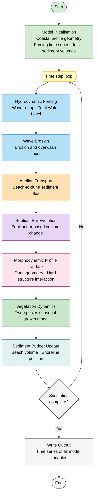
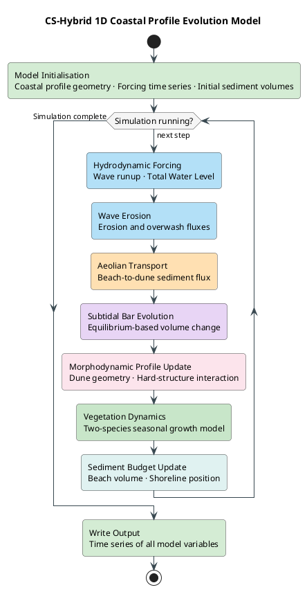

# CS-Hybrid Model — Simulation Flowchart

This document provides a high-level scientific overview flowchart of the **CS-Hybrid 1D Coastal Profile Evolution Model** in both Mermaid and PlantUML formats, suitable for use as a figure in a scientific paper.

---

## A) Mermaid Diagram

---

## B) PlantUML Diagram

---

## Legend

### Module Colour Key

| Colour | Module | Description |
|--------|--------|-------------|
| 🟢 Green | **Initialisation / Output** | Profile setup, forcing loading, result writing |
| 🟡 Yellow | **Time loop** | Main integration loop |
| 🔵 Blue | **Hydrodynamics** | Wave runup, total water level, erosion and overwash |
| 🟠 Orange | **Aeolian transport** | Wind-driven beach-to-dune sediment flux |
| 🟣 Purple | **Subtidal bar** | Equilibrium bar volume and exchange with beach |
| 🔴 Red | **Morphodynamics** | Cross-shore profile update, hard-structure interaction |
| 🌿 Dark green | **Vegetation** | Two-species seasonal growth and decay |
| 🩵 Teal | **Sediment budget** | Beach volume balance and shoreline position |

---

### Key Variables

| Symbol | Meaning |
|--------|---------|
| **Hs** | Significant wave height [m] |
| **Tp** | Peak wave period [s] |
| **SWL** | Still water level (tide + surge) [m] |
| **TWL** | Total water level = wave runup + SWL [m] |
| **SLR** | Sea-level rise rate [m/yr] |
| **ρ₁, ρ₂** | Vegetation cover fraction, pioneer & mature species [-] |

